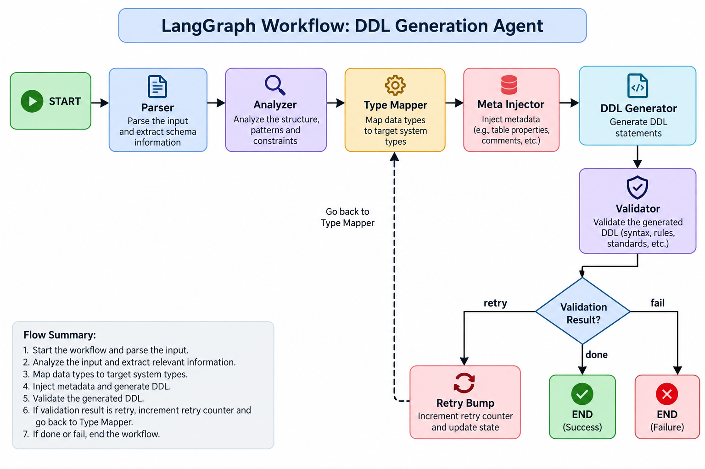

# Schema Migrator — Agentic Cross-Dialect DDL Transpiler

> **Deterministic-first, LLM-as-fallback.** Transpile Oracle / PostgreSQL schemas into
> BigQuery, ClickHouse, or Snowflake DDL with correct type mapping, automatic
> partitioning, clustering, and audit columns — in milliseconds, with zero LLM cost on
> well-formed inputs.

[](https://www.python.org/)
[](https://github.com/langchain-ai/langgraph)
[](https://github.com/langchain-ai/langchain)
[](https://modelcontextprotocol.io/)
[](#license)

---

## Table of Contents

1. [Overview](#overview)
2. [Architecture](#architecture)
3. [How It Works](#how-it-works)
4. [Key Features](#key-features)
5. [Advantages](#advantages)
6. [Limitations & Known Constraints](#limitations--known-constraints)
7. [Supported Dialects](#supported-dialects)
8. [Prerequisites](#prerequisites)
9. [Installation](#installation)
10. [Configuration](#configuration)
11. [Usage](#usage)
    - [CLI](#cli)
    - [Python Library](#python-library)
    - [MCP Server](#mcp-server)
12. [MCP Integration](#mcp-integration)
13. [Input Formats](#input-formats)
14. [Output Structure](#output-structure)
15. [Observability](#observability)
16. [Extending with New Dialects](#extending-with-new-dialects)
17. [Docker & CI](#docker--ci)
18. [Troubleshooting](#troubleshooting)
19. [Project Structure](#project-structure)
20. [License](#license)

---

## Overview

**Schema Migrator** is an agentic schema transpilation system that converts `CREATE TABLE`
DDL statements (or YAML schema definitions) from Oracle / PostgreSQL source dialects into
fully optimized DDL for modern cloud data warehouses: **BigQuery**, **ClickHouse**, and
**Snowflake**.

It is built on top of **LangChain** and **LangGraph**, exposing a stateful multi-agent
pipeline where each stage — parsing, analysis, type mapping, metadata injection, DDL
generation, and validation — runs as an isolated graph node. The LLM is only invoked as a
fallback when deterministic rules cannot resolve a type or layout decision, keeping the
system fast, cheap, and auditable by default.

The transpiler ships in three consumption modes:

| Mode | Entrypoint |
|------|-----------|
| **CLI** | `schema-migrate transpile ...` |
| **Python library** | `from schema_migrator import transpile` |
| **MCP server** | `python -m schema_migrator.mcp_server` |

This makes it suitable for standalone use, pipeline integration, and AI-agent orchestration
(Claude Code, Cursor, Antigravity, or any MCP-compliant host).

---

## Architecture

The system is implemented as a **LangGraph stateful directed graph**. Each node in the
graph is a standalone agent responsible for a well-defined transformation step. State flows
forward through the pipeline; on validation failure the graph retries from the Type Mapper
node up to a configurable maximum.



### Graph Nodes

| Node | Role | LLM? |
|------|------|-------|
| **Parser** | Parse SQL / YAML input and extract the raw schema | LLM fallback only |
| **Analyzer** | Detect partition / clustering columns from name patterns and hints | LLM fallback only |
| **Type Mapper** | Map source types to target types via YAML rulebooks | LLM fallback only |
| **Meta Injector** | Inject mandatory audit columns (`_ingested_at`, `_source_hash`, `_source_system`) | Never |
| **DDL Generator** | Render dialect-specific `CREATE TABLE` DDL | Never |
| **Validator** | Round-trip parse with sqlglot and apply semantic checks | Never |
| **Retry Bump** | Increment retry counter and route back to Type Mapper | Never |

---

## How It Works

```
Input (SQL / YAML)
       │
       ▼
   ┌─────────┐     ┌──────────┐     ┌─────────────┐     ┌───────────────┐
   │  Parser  │────▶│ Analyzer │────▶│ Type Mapper │────▶│ Meta Injector │
   └─────────┘     └──────────┘     └─────────────┘     └───────────────┘
                                            ▲                     │
                                            │                     ▼
                                     ┌────────────┐       ┌──────────────┐
                                     │ Retry Bump │◀──────│ DDL Generator│
                                     └────────────┘       └──────────────┘
                                                                  │
                                                                  ▼
                                                          ┌───────────────┐
                                                          │   Validator   │
                                                          └───────┬───────┘
                                                  ┌──────────────┼─────────────┐
                                                retry           done           fail
                                                  │              │              │
                                           Retry Bump        END ✅          END ❌
```

### Step-by-step flow

1. **Parser** — sqlglot attempts to parse the raw DDL. If the input is YAML, ruamel.yaml
   extracts the schema. On total failure, the LLM is asked to extract column names and
   types from the raw text.

2. **Analyzer** — Inspects column names and user-supplied hints to decide which column
   drives partitioning and which columns are cluster candidates. Falls back to LLM when no
   pattern matches.

3. **Type Mapper** — Walks each column through the dialect's YAML rulebook
   (`rules/<dialect>_types.yaml`). Exact, prefix, and regex matches are tried in order.
   Unmatched types are passed to the LLM with the column's context. Results carry a
   `confidence` score and `resolved_by` field (`rules` or `llm`).

4. **Meta Injector** — Appends three audit columns required by data-platform standards.
   Collision detection renames conflicting user columns with a `_sys` suffix.

5. **DDL Generator** — The registered `DialectRenderer` renders the final `CREATE TABLE`
   statement with partitioning, clustering, and column-level comments where the target
   dialect supports them.

6. **Validator** — sqlglot round-trip parses the generated DDL and runs semantic checks
   (partition clause emitted, all metadata columns present, no reserved-word collisions).
   Classifies failures as *retryable* or *fatal*.

7. **Routing** — A `retryable` failure increments a counter and sends state back to the
   Type Mapper. A `done` result or exhausted retries exits the graph.

---

## Key Features

- **Deterministic-first design** — YAML rulebooks cover the vast majority of real-world
  types; the LLM is the exception, not the rule.
- **Multi-provider LLM support** — Anthropic Claude, OpenAI GPT-4o, Azure OpenAI, and AWS
  Bedrock; swap with one env-var change.
- **Zero-credential operation** — Set `ENABLE_LLM_FALLBACK=false` for fully offline,
  reproducible pipelines at zero API cost.
- **Auto-partitioning & clustering** — Detects `business_date`, `event_time`, `created_at`
  and common ID columns automatically; explicit YAML hints override heuristics.
- **Automatic audit columns** — Every generated table gets `_ingested_at`, `_source_hash`,
  `_source_system` with dialect-correct types.
- **Self-validating pipeline** — The Validator catches dialect errors before DDL is used;
  retryable failures are automatically re-attempted.
- **Three consumption modes** — CLI, Python library, and MCP server for maximum
  integration flexibility.
- **Full observability stack** — Structured JSON logs (structlog), LangSmith tracing, and
  Prometheus metrics out of the box.
- **Extensible dialect registry** — Add a new target dialect with a YAML rulebook + a
  `DialectRenderer` class.

---

## Advantages

| Advantage | Details |
|-----------|---------|
| **Speed** | Rules-based paths complete in ~20–50 ms; no LLM latency on common inputs |
| **Cost efficiency** | Zero token spend on well-formed inputs; LLM only fires on genuinely ambiguous types |
| **Auditability** | Every column records `resolved_by` (`rules` / `llm`) and a `confidence` score |
| **Reproducibility** | Deterministic rulebooks produce identical output for identical input; CI-safe |
| **Observability** | Per-node latency, LLM token counts, and retry counts are exported as Prometheus metrics and LangSmith spans |
| **Portability** | Python 3.10+, no compiled dependencies; runs on any platform including Docker and GitHub Actions |
| **AI-native** | MCP server makes tools callable from any LLM-based IDE (Claude Code, Cursor) or orchestrator (Antigravity) |
| **Retry resilience** | Configurable retry loop re-maps types and regenerates DDL on validation failure without human intervention |
| **Schema completeness** | Auto-injected audit columns enforce data-platform standards regardless of source quality |

---

## Limitations & Known Constraints

| Area | Limitation |
|------|-----------|
| **Source dialects** | Parser targets Oracle, PostgreSQL, MySQL, and generic ANSI SQL. Exotic proprietary extensions (e.g., Oracle spatial types, partitioned table syntax) may not parse without LLM fallback |
| **Target dialects** | Only BigQuery, ClickHouse, and Snowflake are bundled. Extending to a new dialect requires writing a rulebook and a `DialectRenderer` |
| **LLM quality** | When the LLM fallback fires, output quality depends on the model. Ambiguous multi-column types may receive an approximate mapping with a low confidence score |
| **Complex DDL** | Foreign keys, indexes, triggers, stored procedures, and sequences are not migrated — only table structure and column types |
| **No data migration** | This tool transpiles **schema definitions only**; it does not migrate row data |
| **Single-table scope** | Each transpile call handles one `CREATE TABLE` statement. Multi-statement SQL files are not supported in one call |
| **Partition heuristics** | Automatic partition-column detection relies on column naming conventions; unusual naming requires explicit YAML hints |
| **Bedrock availability** | AWS Bedrock requires an additional install (`pip install .[bedrock]`) and appropriate IAM permissions |
| **Stateless retries** | The retry loop re-runs the Type Mapper from scratch on each attempt; it does not patch individual columns |
| **Cost estimation** | USD cost metrics are estimates based on public pricing and may drift from actual billing |

---

## Supported Dialects

### Source dialects (input)

| Dialect | Notes |
|---------|-------|
| Oracle | `NUMBER`, `VARCHAR2`, `DATE`, `TIMESTAMP WITH TIME ZONE`, spatial types via LLM fallback |
| PostgreSQL | All standard types including `JSONB`, `UUID`, `ARRAY` |
| MySQL | Standard types |
| ANSI SQL | Generic standard SQL |

### Target dialects (output)

| Dialect | Partitioning | Clustering | Notes |
|---------|-------------|-----------|-------|
| **BigQuery** | `PARTITION BY DATE(col)` | `CLUSTER BY col1, col2, ...` | Up to 4 cluster columns |
| **ClickHouse** | `PARTITION BY toDate(col)` | `ORDER BY (col1, col2)` | MergeTree engine |
| **Snowflake** | `CLUSTER BY (col1, col2)` | — | Stage-based clustering |

---

## Prerequisites

- **Python 3.10 or higher**
- An LLM API key (optional — only needed for the LLM fallback path):
  - [Anthropic](https://console.anthropic.com/) — recommended
  - [OpenAI](https://platform.openai.com/)
  - Azure OpenAI deployment
  - AWS credentials with Bedrock access
- [LangSmith](https://smith.langchain.com/) API key (optional, for tracing)

---

## Installation

```bash
# 1. Clone the repository
git clone <repo-url>
cd schema-migration-agent

# 2. Create and activate a virtual environment
python -m venv .venv

# Windows
.venv\Scripts\activate
# macOS / Linux
source .venv/bin/activate

# 3. Install (choose one)
pip install -e ".[dev]"      # development: includes pytest, ruff, mypy
pip install -e .             # runtime only
pip install -e ".[bedrock]"  # runtime + AWS Bedrock support

# 4. Verify
schema-migrate dialects
# - bigquery
# - clickhouse
# - snowflake

pytest -q
# All tests pass
```

---

## Configuration

All runtime settings are loaded from environment variables or an `.env` file in the project
root. Copy the provided template:

```bash
cp .env .env.local   # edit .env.local with your values
```

> **Note:** The `.env` file is already present in the repo as a blank template. Fill in
> only the block for your chosen LLM provider; everything else is optional.

### Core environment variables

| Variable | Default | Description |
|----------|---------|-------------|
| `LLM_PROVIDER` | `anthropic` | Active provider: `anthropic` / `openai` / `azure` / `bedrock` |
| `ENABLE_LLM_FALLBACK` | `true` | Allow LLM for unknown types and missing partition hints |
| `MAX_VALIDATION_RETRIES` | `2` | Max retry iterations through the type-mapper → validator loop |
| `LOG_FORMAT` | `json` | `json` (production) or `console` (development) |
| `LOG_LEVEL` | `INFO` | `DEBUG` / `INFO` / `WARNING` / `ERROR` |
| `METRICS_ENABLED` | `false` | Expose Prometheus metrics on `METRICS_PORT` |
| `METRICS_PORT` | `9090` | HTTP port for the Prometheus metrics endpoint |
| `LANGCHAIN_TRACING_V2` | `false` | Send traces to LangSmith |
| `LANGCHAIN_API_KEY` | — | LangSmith API key |
| `LANGCHAIN_PROJECT` | `schema-migrator` | LangSmith project name |

### Provider credential blocks

<details>
<summary>Anthropic (recommended)</summary>

```env
LLM_PROVIDER=anthropic
ANTHROPIC_API_KEY=sk-ant-...
```
</details>

<details>
<summary>OpenAI</summary>

```env
LLM_PROVIDER=openai
OPENAI_API_KEY=sk-proj-...
```
</details>

<details>
<summary>Azure OpenAI</summary>

```env
LLM_PROVIDER=azure
AZURE_OPENAI_API_KEY=...
AZURE_OPENAI_ENDPOINT=https://<resource>.openai.azure.com
AZURE_OPENAI_API_VERSION=2024-06-01
AZURE_OPENAI_DEPLOYMENT=gpt-4o
```
</details>

<details>
<summary>AWS Bedrock</summary>

```env
LLM_PROVIDER=bedrock
AWS_REGION=us-east-1
BEDROCK_MODEL_ID=anthropic.claude-3-5-sonnet-20240620-v1:0
# Uses the default AWS credential chain (IAM role, ~/.aws/credentials, etc.)
```
</details>

### Deterministic mode (no LLM, zero cost)

```env
LLM_PROVIDER=anthropic
ENABLE_LLM_FALLBACK=false
LOG_FORMAT=console
```

---

## Usage

### CLI

The `schema-migrate` command is installed automatically with the package.

#### Transpile a SQL file

```bash
schema-migrate transpile --source tests/fixtures/oracle.sql --target bigquery
```

Output — a rich panel with the generated DDL, a warnings table, and a metrics footer:

```
+─────────────────────── bigquery DDL ───────────────────────+
│ CREATE TABLE IF NOT EXISTS sales.orders (                   │
│   order_id INT64 NOT NULL,                                  │
│   customer_id INT64,                                        │
│   business_date DATE,                                       │
│   _ingested_at TIMESTAMP,                                   │
│   _source_hash STRING,                                      │
│   _source_system STRING                                     │
│ )                                                           │
│ PARTITION BY DATE(business_date)                            │
│ CLUSTER BY order_id, customer_id;                           │
+─────────────────────────────────────────────────────────────+
trace_id=8dcfb4508df7  duration=22.9ms  llm_calls=0  tokens=0/0  cost=$0.0000
```

#### Save output to a file

```bash
schema-migrate transpile \
  --source schemas/orders.sql \
  --target bigquery \
  --out generated/orders.bq.sql
```

#### Transpile a YAML schema

```bash
schema-migrate transpile \
  --source schemas/orders.yaml \
  --target snowflake
```

#### JSON output (for scripting)

```bash
schema-migrate transpile \
  --source schemas/orders.sql \
  --target clickhouse \
  --json | jq '.target_ddl'
```

#### Validate an existing DDL

```bash
schema-migrate validate --ddl generated/orders.bq.sql --dialect bigquery
# OK — parses cleanly.
```

#### List registered target dialects

```bash
schema-migrate dialects
```

#### Batch a directory

```bash
for f in schemas/*.sql; do
  schema-migrate transpile \
    --source "$f" \
    --target bigquery \
    --out "generated/$(basename "${f%.sql}").bq.sql"
done
```

#### CLI exit codes

| Code | Meaning |
|------|---------|
| `0` | Transpile succeeded and validation passed |
| `2` | Transpile ran but validation failed (DDL still emitted) |
| `1` | Bad arguments, unreadable input, or unregistered dialect |

---

### Python Library

#### Quick one-liner

```python
from schema_migrator import transpile

result = transpile(open("schemas/orders.sql").read(), target_dialect="bigquery")
print(result.target_ddl)
```

#### With options

```python
from schema_migrator import transpile, TranspileOptions

result = transpile(
    source=open("orders.sql").read(),
    target_dialect="snowflake",
    source_format="sql",        # "auto" | "sql" | "yaml"
    options=TranspileOptions(include_metrics=True),
)
```

#### Inspect the full result

```python
print("trace_id :", result.trace_id)
print("dialect  :", result.target_dialect)
print("passed   :", result.validation.passed)
print("warnings :", result.warnings)

for agent, ms in result.metrics.per_agent_ms.items():
    print(f"  {agent:15} {ms:6.1f} ms")

m = result.metrics
print(f"llm_calls={m.llm_calls}  tokens={m.tokens_in}/{m.tokens_out}  cost=${m.cost_usd:.6f}")
```

#### Use as a parser only

```python
result = transpile(sql, target_dialect="bigquery")
for col in result.parsed_schema.columns:
    print(col.name, col.source_type, col.hints.is_business_date)
```

#### Stream graph nodes (advanced)

```python
from schema_migrator.graph import build_graph
from schema_migrator.models.state import AgentState

app = build_graph()
state = AgentState(raw_input=open("t.sql").read(), target_dialect="bigquery", trace_id="run-1")
for step in app.stream(state):
    print(step)   # each node's partial state as it completes
```

---

### MCP Server

Run the transpiler as a **Model Context Protocol stdio server** for use with any
MCP-compatible AI agent or IDE:

```bash
python -m schema_migrator.mcp_server
```

The server exposes three tools:

| Tool | Signature | Description |
|------|-----------|-------------|
| `transpile_schema` | `(source, target_dialect, source_format?)` | Full pipeline: parse → map → generate → validate |
| `validate_ddl` | `(ddl, dialect)` | sqlglot round-trip parse check |
| `list_dialects` | `()` | Returns the list of registered target dialects |

---

## MCP Integration

The `.mcp.json` in the project root pre-configures the MCP server for any host:

```json
{
  "mcpServers": {
    "schema-migrator": {
      "command": "python",
      "args": ["-m", "schema_migrator.mcp_server"],
      "env": { "PYTHONUNBUFFERED": "1" }
    }
  }
}
```

### Claude Code

Open this repo in Claude Code — the MCP server registers automatically because `.mcp.json`
exists.

```bash
claude
> /mcp
# schema-migrator: connected — 3 tools
```

Then just ask:

> Transpile `schemas/orders.sql` to BigQuery and save the result to `generated/orders.bq.sql`.

### Cursor

Copy the same block into `~/.cursor/mcp.json` or the project-local `.cursor/mcp.json`.
Cursor auto-restarts the server on config changes.

### Antigravity

Open the repo folder in Antigravity. The server appears in the MCP tools panel. Example
prompt:

> Use `transpile_schema` to convert all `.sql` files in `schemas/` to Snowflake DDL.
> Report any columns that fell back to LLM resolution.

### Pass credentials to the MCP server

Add credentials to the `env` block of `.mcp.json` (or keep them in the `.env` file, which
pydantic-settings picks up automatically):

```json
"env": {
  "PYTHONUNBUFFERED": "1",
  "LLM_PROVIDER": "anthropic",
  "ANTHROPIC_API_KEY": "sk-ant-..."
}
```

---

## Input Formats

### SQL (`CREATE TABLE`)

Any DDL that sqlglot can parse — Oracle, PostgreSQL, MySQL, or generic ANSI SQL. Format is
auto-detected; override with `--source-format sql`.

Partition and clustering hints are inferred automatically from column names:

| Name pattern | Effect |
|---|---|
| `business_date`, `event_date`, `event_time`, `created_at`, `load_date`, `partition_date` | Treated as the partition column |
| `*_id`, `customer`, `product`, `order`, common business keys | Suggested as cluster candidates |
| Column comment or name contains `partition_key` / `cluster_key` | Explicit hint — always honored |

### YAML

```yaml
table: sales_fact
schema: warehouse
source_dialect: oracle       # oracle | postgres | mysql | ansi
primary_key: [order_id]
columns:
  - name: order_id
    type: NUMBER(18,0)
    nullable: false
    comment: "Business key"

  - name: business_date
    type: DATE
    partition_key: true       # drives PARTITION BY
    business_date: true

  - name: customer_id
    type: NUMBER(18,0)
    cluster_key: true
    cluster_order: 1
```

---

## Output Structure

Every transpile call returns a `TranspileResult` object (or JSON when `--json` is used):

```json
{
  "target_ddl": "CREATE TABLE IF NOT EXISTS ...",
  "target_dialect": "bigquery",
  "warnings": ["order_amount: no rule matched 'SDO_GEOMETRY'; used LLM fallback"],
  "validation": {
    "passed": true,
    "issues": [],
    "retryable": false
  },
  "analysis": {
    "partition_column": "business_date",
    "cluster_columns": ["order_id", "customer_id"],
    "inferred_by_llm": false,
    "warnings": []
  },
  "metrics": {
    "duration_ms": 22.89,
    "llm_calls": 0,
    "tokens_in": 0,
    "tokens_out": 0,
    "cost_usd": 0.0,
    "per_agent_ms": {
      "parser": 5.9,
      "analyzer": 0.18,
      "type_mapper": 9.49,
      "meta_injector": 0.3,
      "ddl_generator": 4.1,
      "validator": 3.0
    }
  },
  "trace_id": "8dcfb4508df7"
}
```

### Automatically injected audit columns

Regardless of input, every generated table includes these three columns:

| Column | BigQuery | ClickHouse | Snowflake |
|--------|----------|-----------|-----------|
| `_ingested_at` | `TIMESTAMP` | `DateTime64(6,'UTC')` | `TIMESTAMP_TZ` |
| `_source_hash` | `STRING` | `String` | `STRING` |
| `_source_system` | `STRING` | `Nullable(String)` | `STRING` |

> If any user column conflicts with these names, the injected column is renamed with a
> `_sys` suffix (e.g., `_ingested_at_sys`).

---

## Observability

### Structured JSON logs

Every run emits one JSON line per lifecycle event to **stderr**:

```json
{"trace_id":"8dcfb450","target":"bigquery","event":"transpile.start","level":"info"}
{"agent":"parser","trace_id":"8dcfb450","duration_ms":5.9,"event":"agent.end","level":"info"}
{"trace_id":"8dcfb450","status":"ok","duration_ms":22.89,"cost_usd":0.0,"event":"transpile.done"}
```

Set `LOG_FORMAT=console` for colorized human-readable output during development.

### LangSmith tracing

```env
LANGCHAIN_TRACING_V2=true
LANGCHAIN_API_KEY=lsv2_pt_...
LANGCHAIN_PROJECT=schema-migrator
```

Every run appears as a trace at [smith.langchain.com](https://smith.langchain.com) with
each graph node as a span and every LLM call showing prompt, response, token counts, and
latency.

### Prometheus metrics

```env
METRICS_ENABLED=true
METRICS_PORT=9090
```

`http://localhost:9090/metrics` exports:

| Metric | Labels | Description |
|--------|--------|-------------|
| `schema_migrator_transpile_runs_total` | `dialect`, `status` | Run count |
| `schema_migrator_agent_duration_seconds` | `agent` | Per-node latency histogram |
| `schema_migrator_llm_calls_total` | `model` | LLM invocation count |
| `schema_migrator_llm_tokens_total` | `model`, `direction` | Token throughput |
| `schema_migrator_llm_cost_usd_total` | `model` | Estimated USD spend |
| `schema_migrator_validation_retries_total` | `dialect` | Retry loop activations |

---

## Extending with New Dialects

Adding a new target dialect requires three steps:

### 1. Add a type-mapping rulebook

Create `src/schema_migrator/rules/<dialect>_types.yaml`:

```yaml
type_mappings:
  - source: NUMBER
    target: BIGINT
    match: prefix
  - source: VARCHAR2
    target: TEXT
    match: prefix
metadata_columns:
  - name: _ingested_at
    type: TIMESTAMPTZ
  - name: _source_hash
    type: TEXT
  - name: _source_system
    type: TEXT
```

### 2. Implement a `DialectRenderer`

Create `src/schema_migrator/dialects/<dialect>.py`:

```python
from schema_migrator.dialects.base import DialectRenderer

class MyDialectRenderer(DialectRenderer):
    dialect_name = "mydialect"

    def render(self, state) -> str:
        ...  # produce CREATE TABLE DDL string
```

### 3. Register the renderer

In `src/schema_migrator/dialects/__init__.py`:

```python
from schema_migrator.dialects.mydialect import MyDialectRenderer
registry.register(MyDialectRenderer)
```

4. Add fixtures and tests under `tests/`. Run `pytest` to confirm.

See [`docs/extending_dialects.md`](docs/extending_dialects.md) for a full walkthrough.

---

## Docker & CI

### Dockerfile

```dockerfile
FROM python:3.12-slim
WORKDIR /app
COPY pyproject.toml README.md ./
COPY src ./src
RUN pip install --no-cache-dir .
ENTRYPOINT ["schema-migrate"]
```

```bash
docker build -t schema-migrator .
docker run --rm -v "$PWD:/w" -w /w schema-migrator \
    transpile --source /w/orders.sql --target bigquery
```

### GitHub Actions

```yaml
name: DDL Transpile
on: [pull_request]
jobs:
  ddl:
    runs-on: ubuntu-latest
    steps:
      - uses: actions/checkout@v4
      - uses: actions/setup-python@v5
        with: { python-version: "3.12" }
      - run: pip install -e ".[dev]"
      - run: pytest -q
      - name: Transpile schemas
        run: |
          for f in schemas/*.sql; do
            schema-migrate transpile \
              --source "$f" --target bigquery \
              --out "generated/$(basename "${f%.sql}").bq.sql"
          done
      - uses: actions/upload-artifact@v4
        with: { name: bq-ddls, path: generated/ }
```

---

## Troubleshooting

<details>
<summary><strong>Unknown target dialect</strong></summary>

```
Error: Unknown target 'xyz'
```

Run `schema-migrate dialects` for the registered list. Add a new dialect by following
[Extending with New Dialects](#extending-with-new-dialects).
</details>

<details>
<summary><strong>No credentials configured for provider</strong></summary>

```
LLMUnavailable: No credentials configured for provider 'anthropic'
```

Either set the relevant API key env var or disable LLM fallback entirely:

```env
ENABLE_LLM_FALLBACK=false
```

The pipeline will then pass unknown types through unchanged with a warning.
</details>

<details>
<summary><strong>Validation fails with PARTITION BY not emitted</strong></summary>

The analyzer couldn't identify a partition column. Fix any one of:

- Add `partition_key: true` to the intended column in your YAML input.
- Rename the column to a recognized pattern (`business_date`, `event_time`, `created_at`, etc.).
- Enable LLM fallback so the analyzer can infer one.
</details>

<details>
<summary><strong>sqlglot parse failed</strong></summary>

The source DDL contains syntax that sqlglot doesn't recognize. Enable `ENABLE_LLM_FALLBACK=true`
to let the parser agent extract the schema via an LLM prompt.
</details>

<details>
<summary><strong>Antigravity / Claude Code doesn't see the MCP server</strong></summary>

1. Confirm the working directory is the repo root (contains `.mcp.json`).
2. Run `python -m schema_migrator.mcp_server` manually to verify it starts without errors.
3. Restart the IDE / agent after editing `.mcp.json`.
4. If `python` is not on `PATH`, use an absolute path in the `command` field of `.mcp.json`.
</details>

<details>
<summary><strong>LLM calls and token counts are zero</strong></summary>

This is expected. The deterministic rulebooks cover common types and the LLM is only called
for genuinely ambiguous inputs. To force LLM usage for testing, pass an unknown source
type such as `SDO_GEOMETRY` or `ARRAY<STRUCT<...>>`.
</details>

---

## Project Structure

```
schema-migration-agent/
├── src/schema_migrator/
│   ├── __init__.py              # Public API: transpile(), TranspileOptions
│   ├── cli.py                   # Typer CLI (schema-migrate command)
│   ├── config.py                # pydantic-settings: all env-driven config
│   ├── mcp_server.py            # MCP stdio server
│   ├── agents/
│   │   ├── metadata_agent.py    # Meta Injector node
│   │   ├── ddl_generator_agent.py
│   │   └── validator_agent.py
│   ├── dialects/
│   │   ├── base.py              # DialectRenderer ABC + registry
│   │   ├── bigquery.py
│   │   ├── clickhouse.py
│   │   └── snowflake.py
│   ├── graph/
│   │   ├── workflow.py          # LangGraph graph definition
│   │   └── router.py            # Conditional edge logic
│   ├── llm/
│   │   └── factory.py           # Provider-agnostic LLM factory
│   ├── models/
│   │   ├── schema.py            # ParsedSchema, MappedColumn, etc.
│   │   └── state.py             # AgentState (LangGraph state)
│   ├── observability/
│   │   ├── logger.py            # structlog setup
│   │   ├── metrics.py           # Prometheus counters / histograms
│   │   └── callbacks.py         # log_agent context manager
│   ├── parsers/
│   │   ├── detector.py          # Format auto-detection
│   │   └── yaml_parser.py       # ruamel.yaml schema parser
│   └── rules/
│       ├── bigquery_types.yaml
│       ├── clickhouse_types.yaml
│       └── snowflake_types.yaml
├── tests/
│   ├── fixtures/                # oracle.sql, postgres.sql, schema.yaml
│   ├── conftest.py
│   └── test_type_mapping.py
├── examples/
│   ├── oracle_to_bigquery.py
│   ├── yaml_to_snowflake.py
│   └── postgres_to_clickhouse.py
├── docs/
│   ├── USAGE.md                 # Full usage guide
│   ├── extending_dialects.md
│   ├── antigravity_integration.md
│   └── images/
│       └── langgraph-workflow.png
├── .env                         # Blank credentials template
├── .mcp.json                    # MCP server registration
└── pyproject.toml
```

---

## License

Proprietary — OIP AI Prototype. All rights reserved.

This project is an internal prototype. Redistribution, modification, or commercial use
outside of authorized EPAM / OIP project boundaries is not permitted without explicit
written approval.
